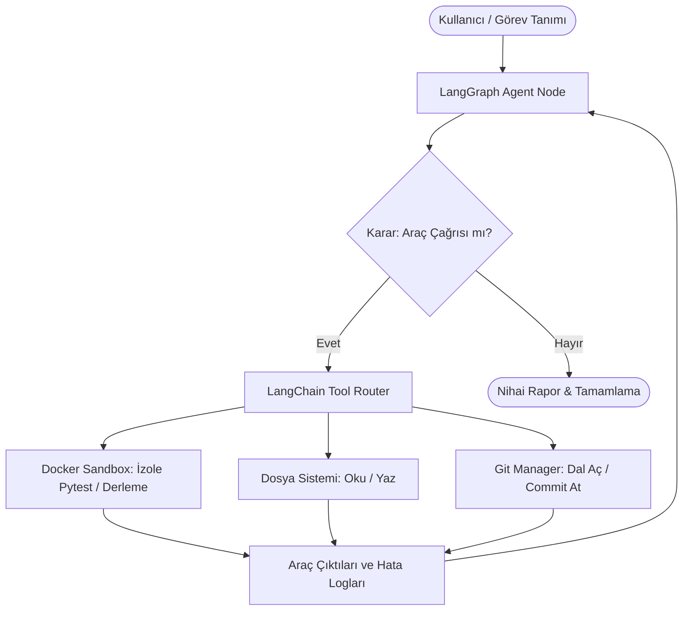

# 🤖 AutoDev-Agent: Otonom Kod İnceleme ve Onarım Ajanı

AutoDev-Agent; yazılım projelerindeki hataları izole bir ortamda tespit eden, test eden ve düzelten otonom bir AI yazılım mühendisliği (SWE) asistanıdır. **LangGraph** durum makinesi, **Docker SDK** ile izole çalıştırma sandbox'ı ve **Gemini 3.8 Flash / 2.5 Flash** modelleri üzerine inşa edilmiştir.

---

## 🏗️ Mimari ve Çalışma Akışı

Ajan, döngüsel bir akıl yürütme grafiği (ReAct döngüsü) üzerinden çalışır. Kod üzerindeki tüm çalıştırma ve test operasyonları ana sistemden tamamen yalıtılmış Docker konteyneri içinde gerçekleşir.



---

## 🌟 Öne Çıkan Özellikler

- **İzole Yürütme (Docker Sandbox):** Kod derleme, bağımlılık yükleme ve test süreçleri ana makineye zarar vermemesi için Ubuntu 22.04 tabanlı konteyner içinde çalıştırılır.
- **Döngüsel Akıl Yürütme (LangGraph):** Ajan hata aldığında pes etmez; hata loglarını okur, hipotez kurar, kodu onarır ve testler geçene kadar süreci yineler.
- **Dahili Versiyon Kontrolü (Git Entegrasyonu):** Hata onarımı öncesi otomatik branch açar (`fix/...`) ve testler başarıyla geçtikten sonra standartlara uygun commit atar.
- **Çift Arayüz Desteği:** Hem terminal (CLI) hem de canlı log akışı sunan web paneli (**Streamlit**) ile çalıştırılabilir.
- **Güvenlik Koridoru:** Sandbox dışına çıkılmasını engelleyen `Path Traversal` doğrulamaları içerir.

---

## 🛠️ Teknoloji Yığını

- **Dil & LLM:** Python 3.10+, Google Gemini API (`gemini-3.8-flash` / `gemini-2.5-flash`), `langchain-google-genai`
- **Ajan Mimarisi:** LangGraph, LangChain Core
- **Sandbox & Güvenlik:** Docker SDK for Python, Ubuntu 22.04
- **Versiyon Kontrolü:** GitPython
- **Kullanıcı Paneli:** Streamlit

---

## 🚀 Kurulum ve Çalıştırma

### 1. Depoyu Klonlayın ve Sanal Ortamı Kurun
```bash
git clone [https://github.com/girayeskici/autodev-agent.git](https://github.com/girayeskici/autodev-agent.git)
cd autodev-agent
python -m venv venv
source venv/bin/activate  # Windows için: venv\Scripts\activate
pip install -r requirements.txt
```

### 2. Ortam Değişkenlerini Tanımlayın
Kök dizinde `.env` dosyasını oluşturun:
```env
GOOGLE_API_KEY=your_gemini_api_key_here
SANDBOX_IMAGE_NAME=autodev-sandbox:latest
WORKSPACE_DIR=workspace
```

### 3. Docker Sandbox İmajını Hazırlayın
```bash
docker build -t autodev-sandbox:latest -f Dockerfile.sandbox .
```

### 4. Çalıştırın

**Web Dashboard (Streamlit):**
```bash
streamlit run app.py
```

**Komut Satırı (CLI):**
```bash
python main.py
```

---

## 👤 Geliştirici
- **Ahmet Giray Eskici** - Mersin Üniversitesi, Bilişim Sistemleri ve Teknolojileri
